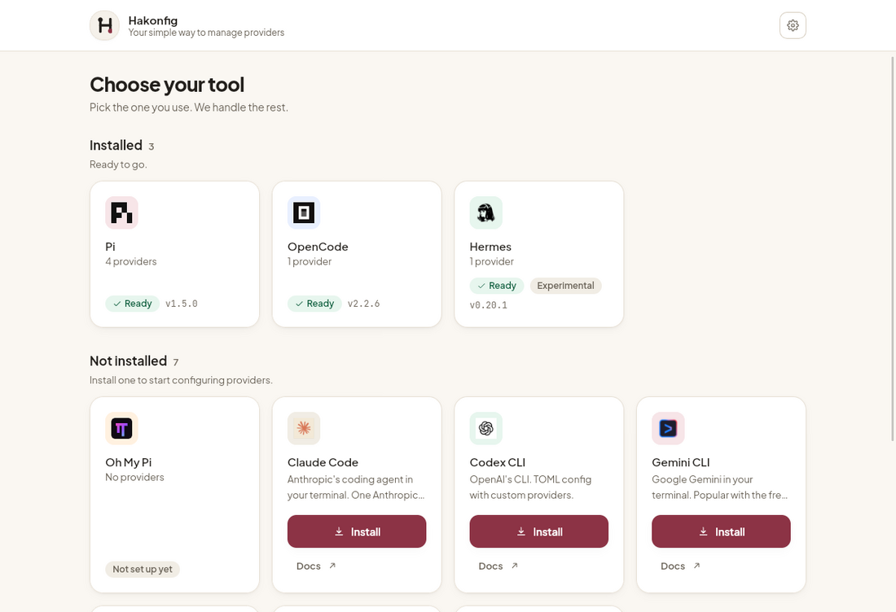
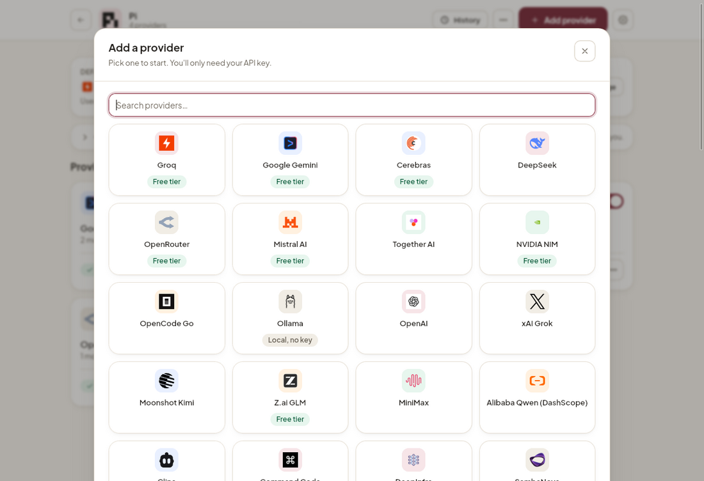
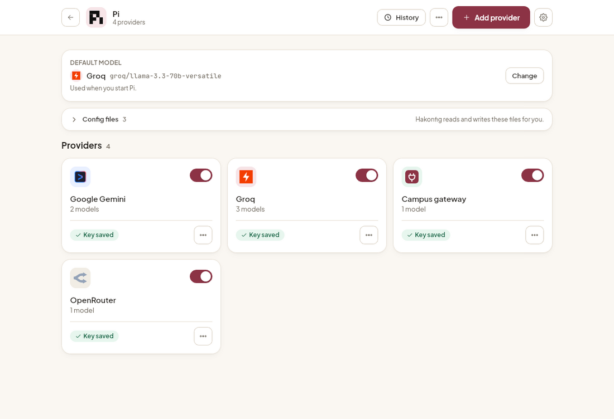

<p align="center">
  <picture>
    <source media="(prefers-color-scheme: dark)" srcset="web/assets/brand/lockup-dark.png">
    
  </picture>
</p>

<p align="center">
  <strong>Your simple way to manage providers</strong><br>
  A free, open-source desktop app that writes the provider config for your AI coding tools.
</p>

<p align="center">
  <a href="https://github.com/perogeremmer/hakonfig/releases/latest">Download</a> ·
  <a href="#get-started">Get started</a> ·
  <a href="#what-it-does">What it does</a> ·
  <a href="#development">Build from source</a> ·
  <a href="LICENSE">MIT license</a>
</p>

---

## Get started

### 1. Install Hakonfig

Grab the latest build from the [releases page](https://github.com/perogeremmer/hakonfig/releases/latest):

| Platform | File | Install |
|---|---|---|
| **Windows 10/11** | `Hakonfig_<version>_x64-setup.exe` | Run the installer. SmartScreen may warn because the build is unsigned: choose **More info → Run anyway**. |
| **macOS** (Apple Silicon + Intel) | `Hakonfig_<version>_universal.dmg` | Open the DMG, drag Hakonfig to Applications. First launch: right click the app, then **Open**. |
| **Linux** (Debian/Ubuntu) | `Hakonfig_<version>_amd64.deb` | `sudo apt install ./Hakonfig_<version>_amd64.deb` |

No account, no telemetry, no server. The app works completely offline; it only talks to a
provider endpoint when you press **Test connection** or **Sync models**.

### 2. Let the first-run scan finish

On the first launch Hakonfig walks through your machine and shows which tools are already
installed, together with how many providers and models each one has. Nothing is written
during this scan.

### 3. Add a provider in three steps

1. Open a tool (for example **Pi**), pick **+ Add provider**.
2. Choose a provider card, paste your API key, press **Test & find models**.
3. Tick the models you want, press **Add N models**, review the diff, then **Apply changes**.

Hakonfig writes the files, keeps a backup of the previous version, and shows the result
in the tool's provider list. To undo, open **History** and restore a backup.

| Step | What it looks like |
|---|---|
| Choose your tool |  |
| Pick a provider |  |
| Manage providers |  |

## What it does

You have a free API key (Groq, Gemini, Cerebras, and so on) and no idea where it goes:
which file, which key, and why the key sometimes lives in a different file than the model
catalog. Hakonfig does it for you: pick your tool, pick a provider, paste the key, review
the diff, write it.

Hakonfig is **not** a proxy or a gateway, and it never stores your keys in its own place.
It only writes to the files your tools already read.

- **Stack:** Tauri v2 (Rust) + HTML + Tailwind CSS v4 + vanilla JS, no frontend framework
- **UI:** Plus Jakarta Sans bundled locally, light and dark themes, English + Bahasa Indonesia
- **CLI:** `hakonfig-cli`, the same engine without a GUI, for servers and scripts
- **Tests:** 184 offline tests (136 Rust + 48 JS), no network required
- **License:** [MIT](LICENSE), free to use, modify, and redistribute

### Open source

Hakonfig is open source under the [MIT License](LICENSE). You can use it commercially, fork
it, embed it, change it, and ship it, as long as the copyright notice and permission notice
are kept. There is no paid tier and no telemetry: the app runs entirely on your machine.

Issues and pull requests are welcome. See [Contributing](#contributing).

---

## Contents

- [Get started](#get-started)
- [What it does](#what-it-does)
- [Features](#features)
- [CLI](#cli)
- [Supported tools](#supported-tools)
- [Providers and logos](#providers-and-logos)
- [Requirements](#requirements)
- [Development](#development)
- [Security model](#security-model)
- [Known limitations](#known-limitations)
- [Troubleshooting](#troubleshooting)
- [Contributing](#contributing)
- [License](#license)

---

## Features

- **Three-step provider setup:** pick a provider card with its real logo, paste the API key,
  hit **Test & find models**, tick the models you want. Base URL, API type, and the model
  list are filled in for you; unticked models are never written.
- **61 built-in provider presets**, from Groq and OpenRouter to Anthropic, Cohere, Chutes,
  Venice, SiliconFlow, BytePlus, Tencent Hunyuan, Volcengine Ark and more, plus **Custom**
  for any OpenAI-compatible endpoint. Each preset ships with a local logo, and the search
  box filters by name as well as id.
- **Custom providers get a neutral mark.** Anything not in the catalog uses the
  OpenAI-compatible logo instead of a two-letter monogram.
- **Registered providers only ask for the key.** For providers that come from the catalog,
  the edit form hides Base URL, API type, id, and display name, because the endpoint is
  already known. Custom providers keep the full form.
- **Environment mode names the variable after the provider.** Choosing "use an environment
  variable" shows exactly the name that gets written and read, e.g. `COMMANDCODE_API_KEY`
  for `commandcode`. The UI and the backend share one rule (`<PROVIDER_ID>_API_KEY`).
- **Light and dark theme**, with locally bundled fonts so it looks identical offline.
- **Bilingual UI:** English by default, Bahasa Indonesia in Settings, switching instantly.
- **Tool versions on the tile** (e.g. `v1.5.0`), detected from `<bin> --version`.
- **Install/uninstall tools** with a progress bar and streamed log, after confirming the
  exact command.
- **Tool catalog** for tools that are not installed yet (Claude Code, Codex CLI, Gemini CLI,
  Aider, Crush, Qwen Code, OpenHands, DeepSeek Harness) with an **Install** button that runs the
  official command.
- **Web apps** (tools that only exist in a browser) can be listed with an **Open** button and a
  short install-as-app guide. No entry uses this yet, so the section stays hidden.
- **Detects config paths** and shows them, with a button to open the folder.
- **Reads the current config** as a list: provider, base URL, API type, key status (masked),
  model count.
- **Diff preview before writing.** Nothing is written silently.
- **Disable is not delete.** On Oh My Pi/OpenCode the provider is added to the tool's own
  disable list; on Pi/Hermes the entry is commented out in the file
  (`// hakonfig:disabled groq`). Data disappears only when you press **Delete**.
- **Automatic backup** on every write, kept at 5 per tool, plus a **restore** panel.
- **Connection test** against the provider endpoint (key validity, latency, sample models).
- **Change the default model** per tool with a searchable list that spans all providers.
- **Safe writes:** merge (unknown fields preserved), atomic write (`tmp` + `rename`),
  `0600` permissions for files that hold credentials.
- **Secrets masked** everywhere in the preview (API keys, tokens, passwords).

---

## CLI

The engine ships as a standalone binary, `hakonfig-cli`, for servers, scripts,
and anyone who prefers a terminal. It calls the exact same `hakonfig_core::api`
as the desktop app, so writes, backups, and redaction behave identically.

### Install

macOS and Linux (bash/zsh):

```bash
curl -fsSL https://raw.githubusercontent.com/perogeremmer/hakonfig/master/scripts/install.sh | sh
```

Windows (PowerShell):

```powershell
irm https://raw.githubusercontent.com/perogeremmer/hakonfig/master/scripts/install.ps1 | iex
```

Also available as:

| Channel | Command |
|---|---|
| Homebrew (macOS/Linux) | `brew install perogeremmer/tap/hakonfig-cli` |
| npm | `npm i -g hakonfig` (or one-off: `bunx hakonfig-cli list`) |
| crates.io | `cargo install hakonfig-cli` |

The npm package is a single install containing the binaries for all three
platforms plus a shim, so the same command works on macOS, Linux, and Windows.

Installs go to `~/.local/bin` (override with `HAKONFIG_INSTALL_DIR`); binaries
are checksum-verified against the release's `SHA256SUMS` before anything is
written. The script follows the latest **published** release, not drafts.

### Usage

```bash
hakonfig-cli list                           # what is installed, with versions
hakonfig-cli show pi                        # current providers of one tool
hakonfig-cli providers --search groq        # browse the preset catalog
hakonfig-cli add --harness pi --provider groq --key-stdin
hakonfig-cli add --harness pi --provider groq --key-stdin --sync   # model list from the endpoint
hakonfig-cli doctor                         # config the harness will not show
hakonfig-cli doctor --fix                   # repair what can be repaired automatically
```

Rules it holds since day one:

- Default output is English; `--lang id` or `HAKONFIG_LANG=id` for Bahasa Indonesia.
- Any flag or `--json` means fully non-interactive: it never prompts (safe for scripts and servers).
- In a terminal without flags, `add` runs as a wizard.
- An explicit `--test` that fails aborts with a non-zero exit code and writes nothing.
- Read-only commands (`list`, `show`, `providers`, `paths`) never touch files.

Every command accepts `--json` for stable, scriptable output. The command
reference and the JSON schemas live in [docs/CLI.md](docs/CLI.md).

---

## Supported tools

| Tool | Status | Files managed |
|---|---|---|
| **Pi** | stable | `~/.pi/agent/models.json` (JSONC) + `auth.json` + `settings.json`¹ |
| **Oh My Pi** | stable | `~/.omp/agent/models.yml` + `config.yml`¹ |
| **OpenCode** | stable | `~/.config/opencode/opencode.json` (or `.jsonc`) + `~/.local/share/opencode/auth.json` |
| **Hermes** | experimental | `~/.hermes/config.yaml` + `~/.hermes/.env` |

¹ read-only, used to show the current default provider/model; never written.

Adding another tool means one adapter file; the UI renders itself from backend data.
See [Adding a new tool](#adding-a-new-tool).

---

## Providers and logos

`src-tauri/crates/core/presets/providers.json` holds the catalog. Each entry needs an `id`, `name`,
`baseUrl`, `api` type, `envVar` and a `models` list; `models` may be empty, in which case
the user fills it with **Sync models** once a key is set.

- The list is curated, filtered to providers that are usable with a plain API key over an
  OpenAI-compatible (or Anthropic/Google) endpoint. OAuth and cookie-based entries, and
  non-chat services (TTS, search, image generation), are intentionally left out because
  this app cannot manage their credentials.
- Model ids in a preset are a snapshot taken from the provider's own `/models` endpoint;
  providers that need a key to list models start empty.
- Logos live in `web/assets/providers/<id>.<svg|png>`. The UI reads the id list from
  `web/assets/providers/logo-index.js`, which is generated:

```bash
bun run logos   # node scripts/sync-logos.mjs
```

`bun run logos` also runs as part of the Tauri `beforeBuildCommand`, and a test fails if the
generated file is stale. Providers without a logo file fall back to `custom.svg` (the
OpenAI-compatible mark), never to a two-letter monogram.

Every asset (fonts, logos, icons, CSS) is bundled locally. Tests fail if an external asset
URL reappears in the HTML, CSS, or JS.

---

## Requirements

Only needed when building from source or running in dev mode.

| Need | Version | Check |
|---|---|---|
| Rust (rustup) | ≥ 1.82 | `cargo --version` |
| Bun | ≥ 1.1 (Node ≥ 20 also works) | `bun --version` |

You do **not** need a global Tauri CLI: it is already a devDependency
(`@tauri-apps/cli`).

### Linux

```bash
# Debian / Ubuntu
sudo apt update
sudo apt install -y build-essential curl wget file libssl-dev \
  libwebkit2gtk-4.1-dev librsvg2-dev libxdo-dev

# Fedora
sudo dnf install -y webkit2gtk4.1-devel openssl-devel curl wget file \
  librsvg2-devel libxdo-devel

# Arch
sudo pacman -S --needed base-devel curl wget file openssl webkit2gtk-4.1 librsvg libxdo
```

Verify with `pkg-config --modversion webkit2gtk-4.1`.

### macOS

```bash
xcode-select --install
```

### Windows

1. **Visual Studio Build Tools** with the *Desktop development with C++* workload
   (MSVC + Windows SDK).
2. **WebView2 Runtime** (preinstalled on Windows 11, downloadable for Windows 10).
3. MSVC Rust toolchain: `rustup default stable-msvc`.

---

## Development

```bash
bun install     # once
bun run dev     # build CSS, then start the app in dev mode
```

`bun run dev` runs `bun run css` first (Tailwind to `web/styles.css`), then `tauri dev`.

### Edit loop you should know about

Tauri **embeds the `web/` assets at compile time**, so there is no hot reload:

| What you changed | What to do |
|---|---|
| Rust files (`src-tauri/src/**`) | `tauri dev` rebuilds and restarts automatically |
| `web/*.html`, `web/*.js` | stop dev and run `bun run dev` again (about 3 s rebuild) |
| `web/styles.src.css` | run `bun run css` (or `bun run css:watch` in another terminal), then restart dev |

The watcher only watches `src-tauri`, so changes under `web/` do not trigger a restart. That
is the trade-off of shipping without a bundler or dev-server.

To try things without touching your real configs, see
[Sandboxing with `HAKONFIG_ROOT`](#sandboxing-with-hakonfig_root).

### Building for distribution

```bash
bun run build          # = bun run css && bun run logos && tauri build
```

Output:

```
src-tauri/target/release/hakonfig                      # binary
src-tauri/target/release/bundle/                       # installers
```

| Build OS | Artifacts |
|---|---|
| Linux | `.deb`, `.rpm`, `.AppImage` |
| macOS | `.app`, `.dmg` |
| Windows | `.msi`, `.exe` (NSIS) |

Build a single bundle type (faster):

```bash
bunx tauri build --bundles deb     # Linux
bunx tauri build --bundles dmg     # macOS
bunx tauri build --bundles nsis    # Windows
```

> **AppImage note:** creating an AppImage downloads `linuxdeploy` and `appimagetool` on
> first use, and the result is much larger (**~84 MB**) because it bundles GTK/WebKit.
> `.deb`/`.rpm` are only **~3 MB** since they use system libraries.

> **Cross-compilation note:** Tauri **cannot** cross-compile. The three-OS release comes
> from a GitHub Actions matrix: `macos-latest`, `ubuntu-22.04`, and `windows-latest`.

### Automated releases

Four workflows live in `.github/workflows/`:

| Workflow | Trigger | What it does |
|---|---|---|
| `ci.yml` | push to `master`, every PR, manual | version check, JS tests, Tailwind build, `cargo test --locked`, `cargo check`, and a `.deb` dry-run build |
| `release.yml` | tag `v*.*.*`, or manual | builds macOS (universal `.dmg`), Windows (NSIS `.exe`), Ubuntu (`.deb`) plus the `hakonfig-cli` binary for each platform, uploads everything to a draft release with `SHA256SUMS`, publishes npm, publishes crates.io, then publishes the release itself |
| `homebrew-tap.yml` | manual, per tag | regenerates `Formula/hakonfig-cli.rb` in `perogeremmer/homebrew-tap` from the release's binaries and their sha256 |
| `publish-crates.yml` | manual, per tag | pushes `hakonfig-core` + `hakonfig-cli` to crates.io without rebuilding the desktop app (idempotent; used when the crates step of `release.yml` was skipped) |

Release flow:

```bash
node scripts/version.mjs bump minor     # 0.2.0 -> 0.3.0, updates every file
git commit -am "chore: release v0.3.0"
git tag v0.3.0
git push --follow-tags
gh workflow run homebrew-tap.yml -f tag=v0.3.0   # after the release is up
```

`release.yml` creates a draft, fills it with assets, and publishes it in its
last job (`gh release edit --draft=false --latest`), so the download links are
live as soon as the run is green — you only need to look at the assets
beforehand if you want to. The npm and crates.io steps skip versions that are
already on the registry, so re-running a failed job is safe.

crates.io is best-effort: a rejection caused by the account rather than the
code (e.g. unverified email) shows up as a warning instead of failing the run,
and `publish-crates.yml` can push the crates afterwards.

### npm packaging

`npm i -g hakonfig` installs one package that carries the binary for every
platform (`bin/hakonfig-cli-darwin`, `-linux-x64`, `-win32-x64.exe`, ~5 MB
compressed) and a `bin.js` shim that picks the right one. Platform-specific
packages were tried first and are not used:

- unscoped names like `hakonfig-win32-x64` are rejected by npm's spam detection
  (`403 Package name triggered spam detection`), permanently and regardless of
  delays or retries;
- scoped names under `@perogeremmer/` publish fine but are stored *restricted* —
  the packument returns 404 for anonymous visitors and the release token may
  not change visibility — so `npm i -g hakonfig` found no binary at all.

To change the layout, edit `scripts/publish-npm.mjs` (the `BINARIES` list) and
keep `npm/hakonfig/bin.js` in sync. After publishing, the script re-reads the
packument without credentials and fails if the version is not publicly
reachable, so a silently private publish cannot ship again.

What CI guards against:

- `node scripts/version.mjs check` fails if `package.json`, `src-tauri/Cargo.toml`,
  `src-tauri/Cargo.lock`, `src-tauri/tauri.conf.json`, and `web/version.js` drift apart.
- The tag must match the app version (`v0.3.0` vs `0.3.0`); otherwise the job stops before
  building anything.
- `build.beforeBuildCommand` runs `bun run css && bun run logos`, so styles and the logo
  index are always regenerated on the runner.

CI builds are **unsigned**. If you ever need signing, add `APPLE_CERTIFICATE`, `APPLE_ID`,
`APPLE_TEAM_ID` (macOS) and `TAURI_SIGNING_PRIVATE_KEY` / `WINDOWS_CERTIFICATE` (Windows)
as repository secrets and pass them to `tauri-action`.

### Tests

```bash
bun run test        # 136 Rust tests + 48 JS tests
bun run test:rust   # cargo test --workspace
bun run test:js     # node --test web/*.test.js
```

All tests run **offline** and never touch your real configs (Rust uses a `HAKONFIG_ROOT`
sandbox).

| Layer | Count | Coverage |
|---|---|---|
| Unit (`engine/doc.rs`) | 19 | JSONC parsing (comments, trailing commas), YAML (empty/null/broken), comment detection, `mask_key`, `is_slug`, `env_name_from`, secret redaction, `.env` edits, `is_changed` |
| Unit (`engine/backup.rs`) | 6 | empty backup, create/list/restore roundtrip, corrupt manifest, newest-first order, retention cap, orphan cleanup |
| Unit (`engine/write.rs`) | 4 | parent dirs, overwrite, no leftover temp file, `0644` vs `0600` |
| Unit (`engine/paths.rs`) | 2 | `HAKONFIG_ROOT` override, `opencode.jsonc` vs `.json` pick |
| Unit (`engine/version.rs`) | 1 | `<bin> --version` output parsing |
| Unit (`cli/src/draft.rs`) | 17 | preset-to-draft mapping, `--models` parsing, endpoint-to-draft merge for `--sync`, custom provider validation, typo suggestions (Levenshtein) |
| Unit (`engine/glob.rs`) | 6 | `enabledModels` matching: `*` vs `**`, `?`, case folding, coverage checks |
| Unit (`engine/adapters/shared.rs`) | 4 | base-URL host parsing, built-in id collision vs. the genuine provider |
| Unit (`cli/src/output.rs`) | 8 | line diff trimming, removed/added budget split, preview rendering |
| Unit (`cli/src/i18n.rs`) | 5 | language parsing, EN/ID message parity |
| Unit (`src/commands.rs`) | 4 | streamed install command execution, failure detection |
| Integration (`engine/tests.rs`) | 29 | merge of unknown fields, key written to the right file, `$ENV` mode, disable/comment behaviour, remove, backup/restore, preview redaction, validation, per-adapter `stored_key` |
| Integration (`cli/tests/cli.rs`) | 31 | the real binary end-to-end: write, env mode, backup, dry-run, `--test` gate, `--sync` against a loopback stub, `doctor` report/fix, language switch, JSON output |
| Unit (`web/diff.js`) | 20 | `lcsDiff`, context trimming, empty files, huge blocks, XSS escaping, output trimming |
| Unit (`web/i18n.test.js`) | 6 | key parity EN/ID, empty values, placeholders, untranslated strings, no em dash |
| Unit (`web/provider-form.test.js`) | 12 | registered-provider detection, env variable naming |
| Unit (`web/form.test.js`) | 4 | no DOM reads after the form closes, payload built from copies |
| Unit (`web/logo-index.test.js`) | 2 | generated logo index matches the assets folder |
| Unit (`web/offline.test.js`) | 4 | no external asset URLs, fonts present on disk |

### Repository layout

```
hakonfig/
├── web/                          # frontend: HTML + Tailwind + vanilla JS (no framework)
│   ├── index.html
│   ├── main.js                   # UI and flows
│   ├── version.js                # APP_VERSION, generated
│   ├── provider-form.js          # registered-provider + env-var logic (pure, tested)
│   ├── diff.js                   # diff logic (separated so it can be tested)
│   ├── i18n/                     # en.js, id.js, index.js
│   ├── icons.js                  # inline SVG icon set
│   ├── assets/brand/             # mark, lockups, app icon sources
│   ├── assets/providers/         # provider logos + generated logo-index.js
│   ├── fonts/                    # bundled webfonts + licenses
│   ├── styles.src.css            # Tailwind source
│   └── styles.css                # build output (gitignored)
├── src-tauri/
│   ├── src/
│   │   ├── main.rs
│   │   └── commands.rs           # UI <-> engine bridge (Tauri commands)
│   ├── crates/
│   │   ├── core/                 # hakonfig-core: the engine as a plain library
│   │   │   ├── presets/
│   │   │   │   ├── providers.json    # provider presets
│   │   │   │   └── harnesses.json    # tool catalog + install commands
│   │   │   └── src/
│   │   │       ├── api.rs        # single entry point shared by UI and CLI
│   │   │       └── engine/
│   │   │           ├── model.rs          # shared types
│   │   │           ├── paths.rs          # per-OS path resolution
│   │   │           ├── doc.rs            # documents: parse / mutate / render / redact
│   │   │           ├── backup.rs         # snapshot + restore + manifest + retention
│   │   │           ├── write.rs          # atomic writes + permissions
│   │   │           ├── preset.rs         # provider preset loader
│   │   │           ├── catalog.rs        # tool catalog for the "not installed" section
│   │   │           ├── version.rs        # `<bin> --version` detection
│   │   │           ├── tests.rs          # integration tests
│   │   │           ├── testutil.rs       # sandbox + mutex for tests
│   │   │           └── adapters/         # one file per tool
│   │   └── cli/                  # hakonfig-cli: the same engine without a GUI
│   │       ├── src/              # main.rs, add.rs, draft.rs, output.rs, i18n.rs
│   │       └── tests/cli.rs      # end-to-end tests of the real binary
│   ├── icons/
│   └── tauri.conf.json
├── docs/UI-CONTRACT.md           # command and type contract between UI and Rust
├── docs/CLI.md                   # CLI command reference + JSON schemas
├── docs/screenshots/             # README images
├── scripts/sync-logos.mjs        # regenerates logo-index.js
├── scripts/version.mjs           # single source of truth for the version number
├── scripts/install.sh            # CLI installer for macOS/Linux (checksum-verified)
├── scripts/install.ps1           # CLI installer for Windows
├── scripts/publish-npm.mjs       # packs + publishes the npm package
├── scripts/gen-homebrew-formula.mjs # writes the Homebrew formula into the tap
├── npm/hakonfig/                 # npm package source: bin.js shim + README
├── .github/workflows/            # ci.yml, release.yml, homebrew-tap.yml, publish-crates.yml
├── CHANGELOG.md
├── LICENSE
└── README.md
```

The engine (`crates/core`) **does not import Tauri at all**: it is a plain
library. The UI has no framework either, and the CLI has no GUI. All three
shells sit on the same `api.rs`, so behaviour cannot drift between them.

### Sandboxing with `HAKONFIG_ROOT`

For development and testing, every tool directory can be redirected to one root:

```bash
./scripts/make-demo-sandbox.sh /tmp/hk-demo
HAKONFIG_ROOT=/tmp/hk-demo bun run dev
```

Mapping: `$HAKONFIG_ROOT/pi`, `/omp`, `/hermes`, `/opencode/config`, `/opencode/data`.

### Adding a new tool

1. Create `crates/core/src/engine/adapters/<name>.rs` implementing the `Adapter` trait:
   `specs()`, `backup_base()`, `snapshot()`, `build()`, plus optional `stored_key()` (used by
   the backend for Test/Sync when the key field is left empty), `experimental()`, and
   `notes()`.
2. Register it in `adapters::all()` (`crates/core/src/engine/adapters/mod.rs`).
3. Add integration tests in `engine/tests.rs`.

The UI **does not need changes**: the tool list, provider list, and forms are rendered from
backend data.

---

## Security model

- Keys stay in the tool's own files (that is how the tools work). Hakonfig never copies them
  into storage of its own.
- Stored keys are read back **only in the backend** (`Adapter::stored_key`) for Test/Sync;
  the value is never sent to the UI.
- Keys are never logged.
- Saving without filling in the key field never touches existing credentials, so renaming a
  provider or editing its models is safe.
- The preview masks secret values, including inside the diff.
- Always **backup first**: `<tool dir>/.hakonfig/backups/<timestamp>/` + `manifest.json`.
  Only the 5 newest backups per tool are kept.
- Atomic writes: a temp file in the same directory, then `rename`.
- Files holding credentials are written with `0600` permissions.
- Nothing is fetched at runtime except provider requests you trigger yourself, and the
  `npm install` command you confirm for a tool.

---

## Known limitations

1. **Comments are lost in JSON/JSONC/YAML files.** Rewriting `models.json`, `models.yml`,
   `opencode.json`, or `config.yaml` drops comments inside them. Hakonfig warns you and always
   makes a backup. `.env` files are unaffected (edited line by line).
2. **Hermes is still experimental.** Only providers and API keys are written; Hermes fetches
   its own model list from the endpoint.
3. **Oh My Pi has no stable separate auth file**, so the key is written as plaintext `apiKey`
   in `models.yml` (`0600` permissions).
4. **OpenCode paths on macOS/Windows** try several candidates (XDG,
   `Library/Application Support`, `%APPDATA%`). Unusual installs may need a tweak in
   `engine/paths.rs`.
5. **Preset model lists are static snapshots.** Providers add and retire models constantly.
   The **Sync models** button pulls the live list from the endpoint.
6. **No hot reload** for `web/`.
7. Tool config schemas can change between versions. Always review the diff and use the backup
   panel if the result looks off.

---

## Troubleshooting

| Symptom | Cause and fix |
|---|---|
| `The system library webkit2gtk-4.1 was not found` | Linux dependencies missing, see [Requirements](#requirements). Check `pkg-config --modversion webkit2gtk-4.1` |
| `error: linker cc not found` (Linux) | `sudo apt install build-essential` |
| `link.exe not found` / MSVC errors (Windows) | Install Visual Studio Build Tools, run `rustup default stable-msvc`, open a new shell |
| `Gtk-Message: Failed to load module "xapp-gtk3-module"` | **Safe to ignore**: a Linux Mint/Cinnamon theme module that is simply absent |
| White window / empty UI | `web/` assets not rebuilt, run `bun run css && bun run dev` |
| Unstyled UI / `styles.css` 404 | `bun run css` was not run |
| Missing provider logos | `bun run logos` was not run after adding icons |
| AppImage build fails | It downloads tools from the internet, use `--bundles deb` |
| Provider missing from a tool | Check the path shown in the UI; make sure the tool has been started at least once |
| `config file could not be parsed` | Hakonfig fails loudly rather than overwriting a broken file. Fix the JSON/YAML first (a backup is available) |
| Want to experiment safely | Use `HAKONFIG_ROOT=/tmp/hk-demo` |
| `cannot update the lock file ... --locked` | A version bump skipped `Cargo.lock`, run `node scripts/version.mjs bump <version>` |

---

## Contributing

Pull requests, issues, and new tool adapters are very welcome. To add a tool, see
[Adding a new tool](#adding-a-new-tool): it is a single adapter file, with no UI changes.

Before sending a PR:

```bash
bun run test            # 136 Rust + 48 JS tests must pass
bun run version:check   # version consistent across files
bun run css && bun run logos
```

Keep UI copy in both `web/i18n/en.js` and `web/i18n/id.js` (a test enforces key parity), keep
new logos as local files in `web/assets/providers/`, and avoid em dashes in user-facing copy.

---

## License

[MIT](LICENSE) © 2026 perogeremmer and contributors.

Anyone is free to use, copy, modify, merge, publish, distribute, sublicense, and/or sell
copies of this software, provided the copyright notice and permission notice are included.
The software is provided **without warranty** of any kind.
