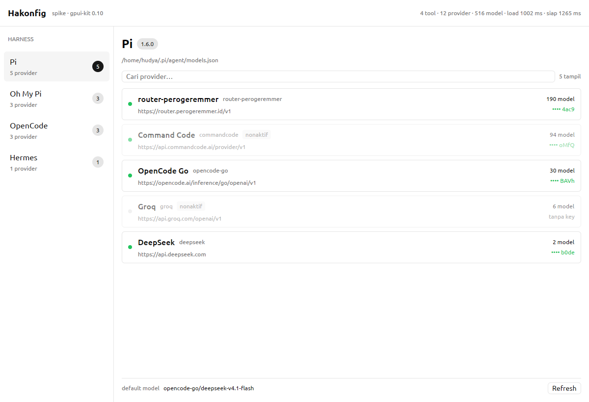
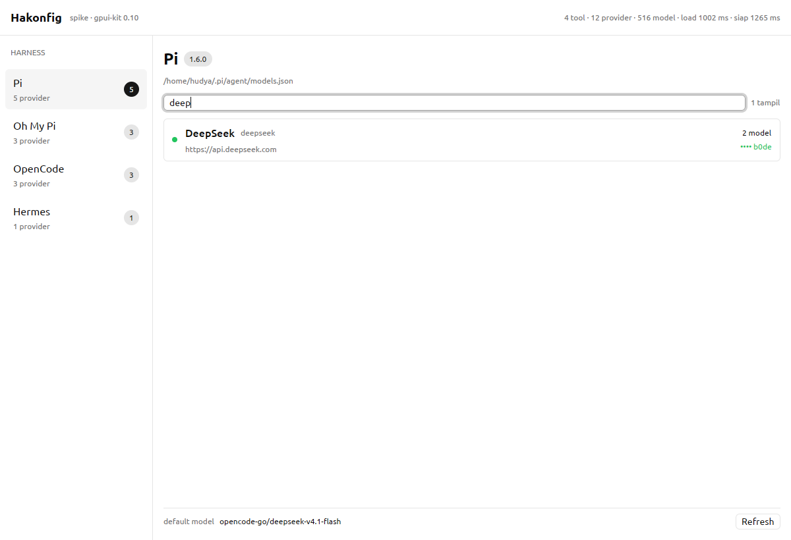

# Spike: layar Providers Hakonfig di atas GPUI Kit

Satu layar, satu tujuan: menjawab dengan angka apakah UI native Rust (GPUI Kit)
layak menggantikan Tauri untuk Hakonfig — bukan dengan opini.

Isi spike ini **596 baris** Rust: sidebar harness, header, daftar provider dengan
pencarian, kartu status key/model, footer default model, tombol refresh.
Semua data datang dari `hakonfig_core::api` yang sama dengan yang dipakai
`hakonfig-cli` dan GUI Tauri. **Nol baris** `hakonfig-core` diubah.




## Jalankan

```sh
cd spike/gpui-kit
cargo run --release          # butuh Rust 1.95+ (lihat catatan toolchain)
./bench.sh                   # ukuran binary, dependency sistem, startup, RSS
./window-startup.sh ./target/release/hakonfig-spike "spike gpui-kit"
```

Linux butuh paket dev: `libxcb`, `libxkbcommon`, `libxkbcommon-x11`
(`libfontconfig`, `libfreetype` sudah jadi dependency umum).

## Angka

Diukur di mesin ini (X11, Rust 1.95.0, profil release tanpa LTO):

| | Tauri 0.7.3 (rilis sekarang) | Spike GPUI Kit |
|---|---|---|
| Binary | **6,3 MB** | 54 MB (42 MB di-strip) |
| Dependency sistem | GTK3 + **WebKitGTK 2.50** + libxcb | libxcb, libxkbcommon, libc |
| Waktu jendela tampil | **64–84 ms** | ~110 ms |
| Frame pertama terlukis | tidak diukur | **167 ms** |
| Data provider siap | tidak diukur | 1263 ms (didominasi spawn proses) |
| RSS | 144 MB | **119 MB** |

Yang lebih penting dari tabel itu: **baca config 4 harness = 2 ms**. Sisa
±1000 ms berasal dari `api::harness_version()`, yang menjalankan `<bin> --version`
(omp saja 604 ms). Biaya itu identik di Tauri; renderer bukan bottleneck.

## Temuan yang perlu dibaca sebelum memutuskan

1. **Core benar-benar bebas UI.** `list_harnesses()`, `read_harness(id)`,
   `harness_version(id)`, `HarnessSnapshot`, `ProviderSummary` dipakai langsung.
   Tidak ada IPC, tidak ada DTO serde, tidak ada `capabilities/*.json`,
   tidak ada `gen/schemas`. Ini keuntungan struktural yang nyata.
2. **gpui-kit butuh Rust ≥ 1.95.** Di stable 1.93 build gagal: `gpui-pre 0.3.12`
   memakai `std::hint::cold_path()` (issue rust-lang#136873). Crate-nya juga
   tidak mendeklarasikan `rust-version`, jadi kegagalannya tidak jelas. Spike ini
   memakai `rust-toolchain.toml` untuk memaku 1.95.0.
3. **Konstruktor view sinkron.** Versi naif (baca config di `new()`) menahan
   frame pertama sampai 1178 ms. Setelah dipindah ke `cx.background_spawn`,
   frame pertama 167 ms dan data menyusul. Porting berarti menambah plumbing
   async di setiap layar, bukan sekadar menerjemahkan HTML.
4. **Default layout mengejutkan.** `h_flex()` di gpui-kit = row **+ items_center**.
   Anak-anaknya jadi center vertikal sampai ditambah `items_stretch()` — bug
   pertama yang muncul di spike ini, dan tipe regresi yang akan berulang di 5
   layar lain.
5. **Font tidak otomatis.** Spike memakai font sistem; Plus Jakarta Sans yang
   sekarang dibundel lewat `@font-face` harus didaftarkan manual ke font registry.
6. **Tidak ada devtools, tidak ada preview browser.** Iterasi = recompile
   (0,4 s untuk crate ini setelah dependency selesai; build dependency penuh
   3 m 53 s sekali di awal).
7. **Binary lebih besar, RAM lebih kecil.** 54 MB vs 6,3 MB, tapi Tauri menumpang
   WebKitGTK sistem — README proyek mencatat AppImage ~84 MB karena membundelnya.
   Untuk distribusi Linux, "tanpa WebKitGTK" adalah keuntungan yang lebih nyata
   daripada angka startup.

## Kesimpulan spike

Porting ke GPUI Kit **layak secara teknis** (core utuh, 596 baris untuk satu layar
yang fungsional), tapi argumen "lebih cepat" tidak terbukti: bottleneck startup
sekarang adalah probe versi tool, dan itu bisa diperbaiki di kode yang ada hari
ini. Argumen yang tersisa dan tetap kuat adalah distribusi Linux tanpa
WebKitGTK, plus hilangnya lapisan IPC.

Sisa pekerjaan untuk port penuh: ±5.400 baris JS/CSS/i18n → estimasi 6–8 ribu
baris Rust (form provider, diff viewer, history/backup, settings, install log
dengan streaming, dialog konfirmasi) ditambah plumbing async per layar.
