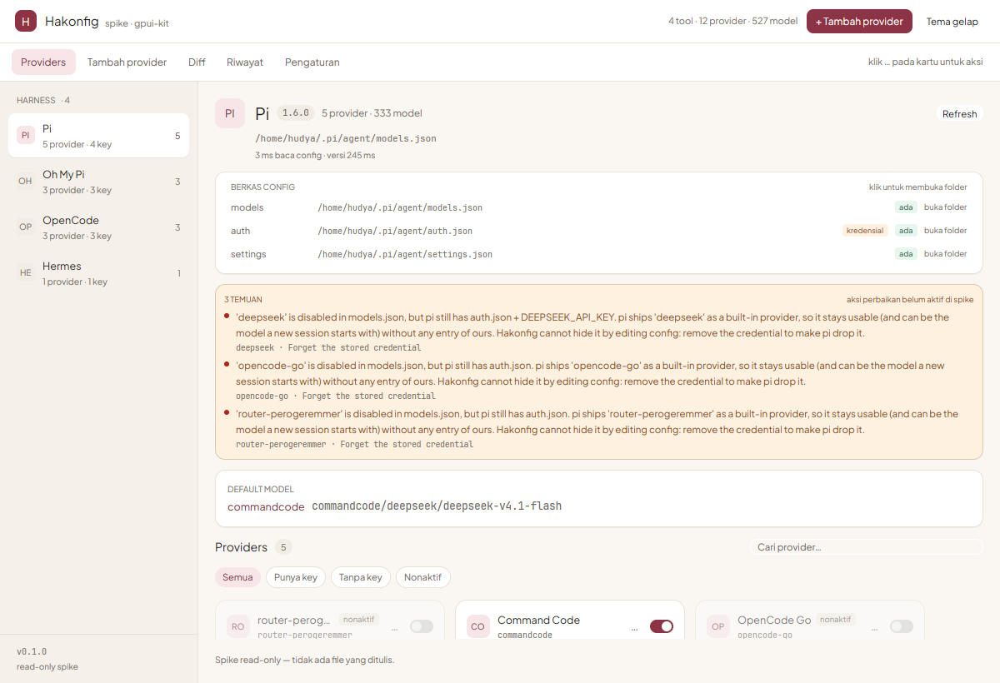
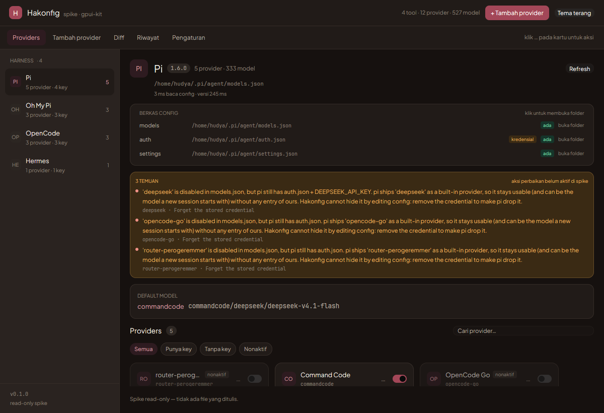
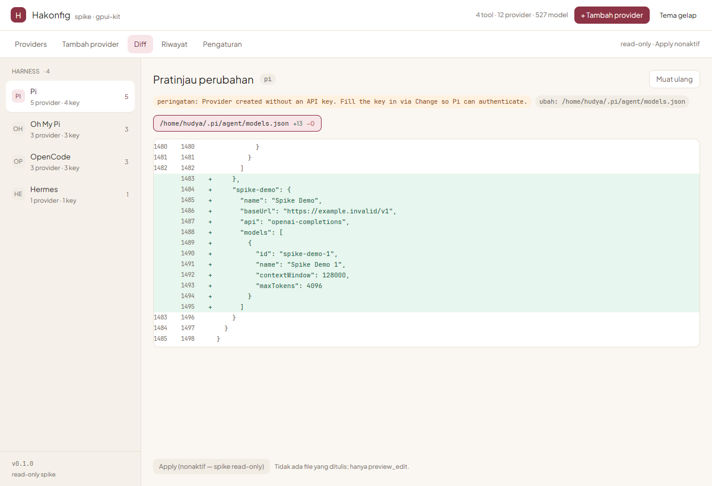
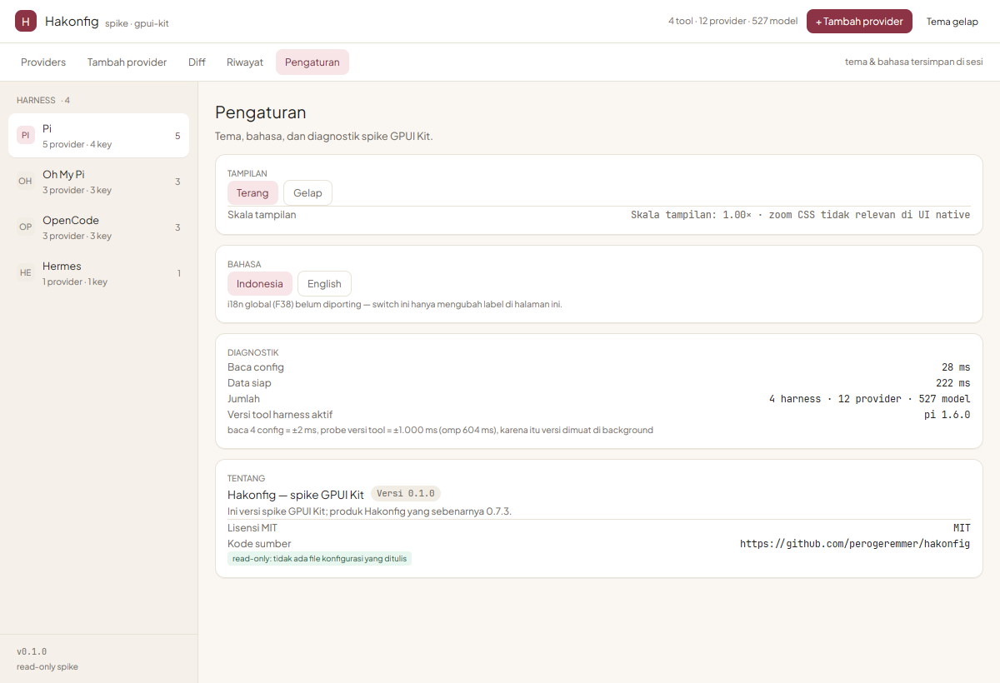
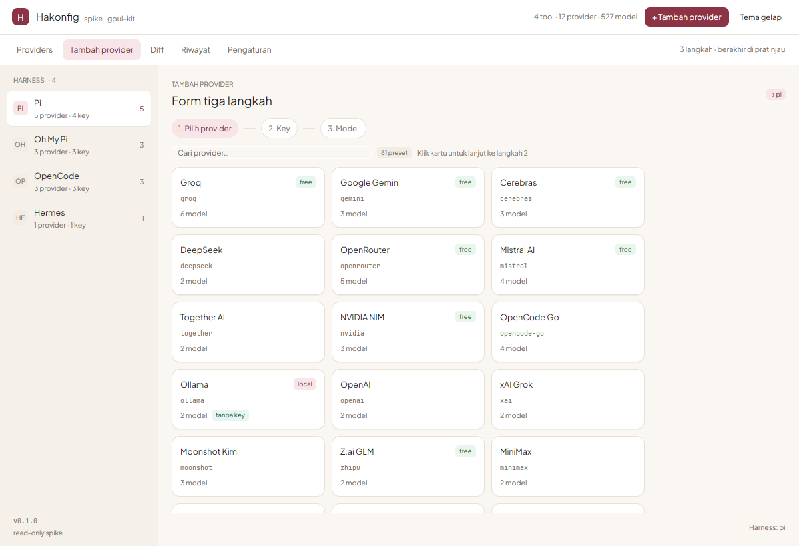
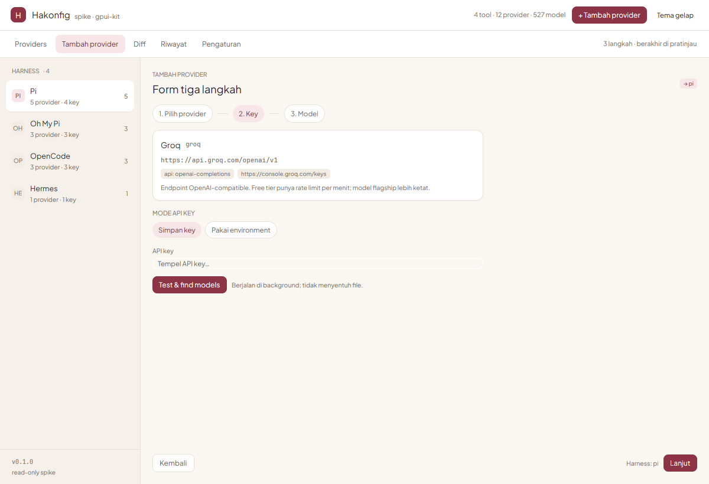
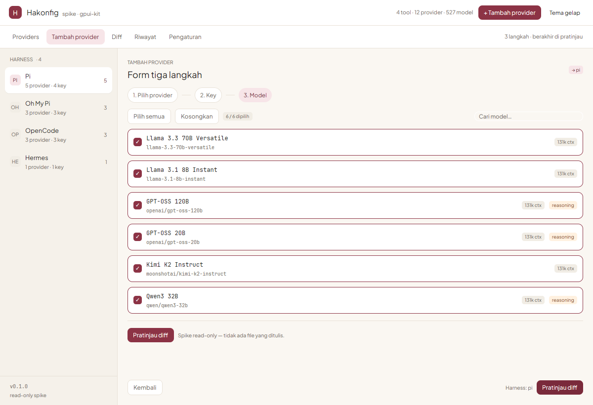
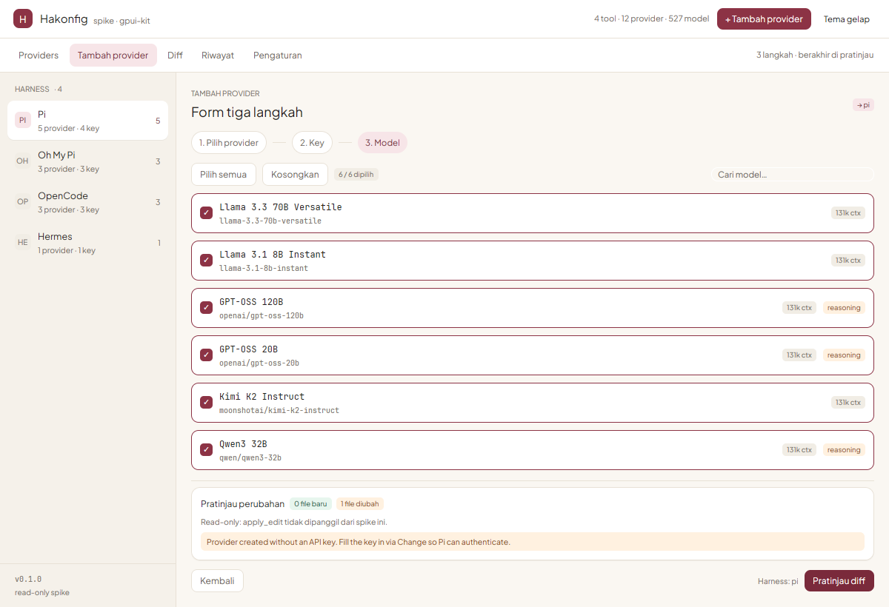
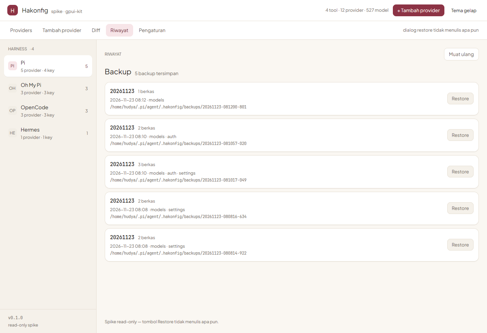
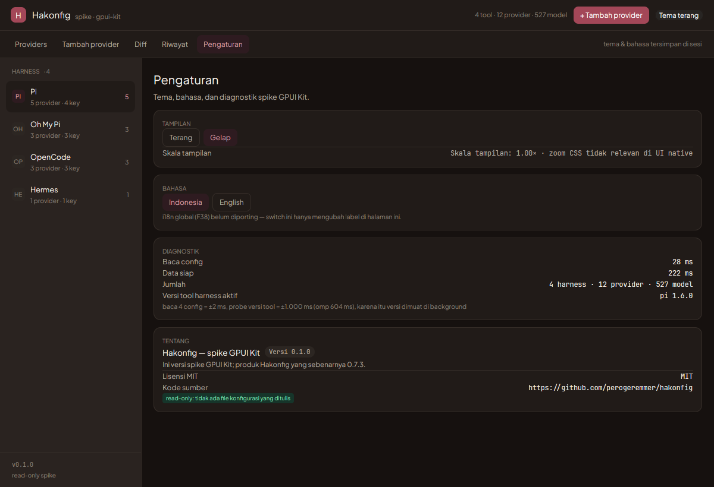

# Spike: Hakonfig di atas GPUI Kit

Port UI Hakonfig dari Tauri (HTML/Tailwind) ke Rust native dengan **GPUI Kit**.
Tujuannya menjawab dua pertanyaan dengan bukti, bukan opini:

1. Apakah `hakonfig_core` bisa dipakai apa adanya oleh UI non-Tauri?
   **Ya** — nol baris core diubah, nol IPC, nol DTO serde.
2. Seberapa jauh tampilan web bisa direproduksi dengan komponen native?
   **Cukup jauh** — palet, font, kartu provider, tema gelap, dialog, toast,
   tabel diff semua native.

| | |
|---|---|
|  |  |
|  |  |
|  |  |
|  |  |
|  |  |

## Jalankan

```sh
cd spike/gpui-kit
cargo run --release         # butuh Rust 1.95+ (lihat rust-toolchain.toml)

./bench.sh                  # ukuran binary, dependency sistem, startup, RSS
./window-startup.sh ./target/release/hakonfig-spike "spike gpui-kit"
```

Linux: `libxcb`, `libxkbcommon`, `libxkbcommon-x11` (dev). `build.rs` menyediakan
taut lokal kalau paket dev `libxkbcommon-x11` belum terpasang.

## Angka (mesin ini, X11, release tanpa LTO)

| | Tauri 0.7.3 | Spike GPUI Kit |
|---|---|---|
| Binary | **6,3 MB** | 59 MB (46 MB di-strip) |
| Dependency sistem | GTK3 + **WebKitGTK 2.50** | libxcb, libxkbcommon, libc |
| Jendela tampil | 64–84 ms | **17–19 ms** |
| Frame pertama berisi data | — | **236 ms** |
| RSS | 144 MB | **128 MB** |

Yang lebih penting dari tabel: **baca 4 config = 29–52 ms**, sedangkan
`harness_version()` (spawn `<bin> --version`) memakan **±1.000 ms** dan identik di
Tauri. Jadi bottleneck startup bukan renderer. Setelah probe versi dipindah ke
background, frame pertama turun dari 1.178 ms (layar kosong) ke 236–387 ms
(data sudah tampil).

## Isi

| Layar | Status | File |
|---|---|---|
| Providers: kartu, cari, filter, toggle, menu aksi | selesai | `src/views/providers.rs` |
| Berkas config + tombol buka folder | selesai | `src/views/providers.rs` |
| Notice/temuan dari `api::list_notices` | selesai | `src/views/providers.rs` |
| Riwayat backup + dialog restore | selesai | `src/views/history.rs` |
| Tambah provider: preset → key → model → pratinjau | selesai | `src/views/add.rs` |
| Diff per file: tab, gutter, warna, masking, Apply nonaktif | selesai | `src/views/diff.rs` |
| Pengaturan: tema, bahasa (ID/EN), diagnostik, tentang | selesai | `src/views/settings.rs` |

Rincian 38 butir + status: [`FEATURES.md`](FEATURES.md). Log kerja: [`PROGRESS.md`](PROGRESS.md).

## Struktur

```
src/main.rs      bootstrap: font, tema, jendela
src/app.rs       state + shell (top bar, tab layar, sidebar harness)
src/data.rs      pembacaan harness lewat hakonfig_core::api
src/net.rs       pembungkus tes koneksi (reqwest butuh reaktor tokio)
src/palette.rs   token warna dari web/styles.src.css + tema gpui-kit
src/views/       satu file per layar; kontraknya new(window, cx) + set_harness()
assets/fonts/    Plus Jakarta Sans + JetBrains Mono (dibundel, OFL)
progress/        catatan per-agent (append-only, digabung ke PROGRESS.md)
```

## Batasan yang disengaja

Spike ini **read-only**: tidak ada `api::apply_edit`, `restore_backup`, atau
`fix_notice`. Semua tombol destruktif ada, tapi hanya menjelaskan panggilan core
yang akan dipakai. Tujuannya menilai toolkit, bukan memigrasikan penulisan file.

## Temuan GPUI Kit yang mahal kalau ditemukan ulang

- Butuh **Rust ≥ 1.95** (`std::hint::cold_path` di `gpui-pre 0.3.12`); crate-nya
  tidak mendeklarasikan `rust-version`, jadi di 1.93 gagal dengan pesan samar.
- `h_flex()` = row **+ items_center**; butuh `items_stretch()` untuk layout penuh.
- `Button::primary()` memakai token `button_primary` dari tema bawaan, bukan
  `ThemeColor` yang kita timpa → warnanya salah. Solusi: `palette::brand_button`.
- Closure dialog dipanggil berulang dan `Div` tidak `Clone` → bangun elemen di
  dalam closure.
- `Theme::update` butuh `&mut App`, sedangkan `cx.listener` hanya memberi
  `&mut Context<Self>`; handler tombol gpui-kit menerima `&mut App`, jadi tombol
  tema memakai closure mentah.
- Konstruktor view harus menerima `&mut Window` kalau ingin `InputState`.
